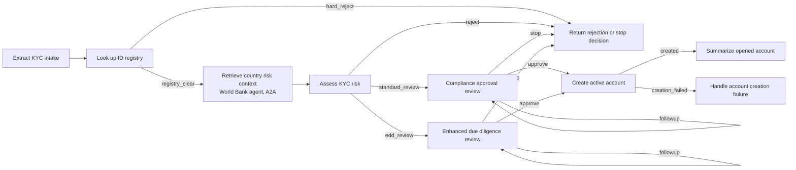

# Try the flows

The paths through the Retail KYC Onboarding workflow that the live services take, each with a request that takes it, the replies to give at each pause, and what you should see.
Requests that name a customer use a real record of the mock ID registry; flows 4 and 5 deliberately use an unknown ID and no details.
All of them run exactly as written; the paths without a flow here are listed under [Not reachable with the live services](#not-reachable-with-the-live-services).
The same flows run as live evals: `FLOW_LIVE_EVALS=1 pytest tests/eval -m live` ([tests/eval/README.md](../../tests/eval/README.md)).

## Before you start

Set `GOOGLE_API_KEY` in `retail_kyc_onboarding/.env` (README, "Add your model keys"), then start the developer UI from the repository root:

```bash
adk web
```

Open http://127.0.0.1:8000, select `retail_kyc_onboarding`, send the request, and answer each pause in the chat.
`adk run retail_kyc_onboarding` works the same way in a terminal.

## How the flow is defined



| Step | What decides the next step |
|------|----------------------------|
| Look up ID registry | `hard_reject` when the lookup fails, there is no record, no ID was given, the registry's ID differs from the request, both names are given and differ, the ID is not ACTIVE, or there is a sanctions hit; otherwise `registry_clear` |
| Assess KYC risk | The model's decision, checked in order: a recommendation containing `REJECT`, or HIGH risk, goes to `reject`; one containing `EDD`, or MEDIUM, to `edd_review`; one containing `APPROVE`, or LOW, to `standard_review`; anything else to `reject` |
| Compliance approval review, Enhanced due diligence review | The officer's reply, searched for these phrases anywhere in the text, even inside other words, stop phrases first: one containing a stop phrase (stop, reject, decline, deny, hold, do not proceed, do not approve, not approved) goes to `stop`; else one containing an approve phrase (approve, approved, proceed, continue, go ahead) to `approve`; anything else asks again. A question that contains one of these phrases counts as that decision, and a negation not in the stop list counts as approval (`Do not continue` and `Disapprove` both approve), so reply with plain `Approve` or `Stop` |
| Create active account | `created` when the accounts API answers with status ACTIVE and an account number; otherwise `creation_failed` |

Names and IDs are compared with case, spaces and punctuation ignored.

## The two kinds of pause

**Review gate.**
Before the KYC Risk Agent writes a review question, a rejection or an account-failure answer (not the opened-account summary), the compliance team's gate pauses the run:

```text
Your application is being reviewed by our compliance team. We’ll continue once the review is complete.

Next step: Compliance approval review. Reply "Proceed" to continue, or "Stop" to stop the run.
```

Only an affirmative reply continues (`Proceed`, `yes`, `approve`, `continue`, `go ahead`, ...), and the whole reply must be one of them; any other reply, `ok` or `Proceed please` included, stops the run, as on Kaya.

**Compliance review question.**
At a review step the KYC Risk Agent writes the question for the officer, for example:

```text
Compliance officer review required before account creation. Applicant: Arturo Conroy; ID number: 57-607128-154274-1; requested product: Savings Account. Registry evidence: record found, registered name Arturo Conroy, ID status ACTIVE. ... KYC risk: LOW. Final recommendation: APPROVE. No account will be created unless the compliance officer replies Approve/Proceed; Stop/Reject/Decline will stop onboarding.

KYC risk: LOW
Recommendation: APPROVE

Reasons:
- Registry record returned with usable registered_name and registry ID number
- Applicant full_name matches registered_name after case-insensitive trimming
- id_status is ACTIVE
```

The wording comes from the model, so it differs from run to run.

## Registry data

`GET https://608b7a57737e470017b74d29.mockapi.io/api/v1/customers?id_number=<id>`:

| Name | ID number | ID status |
|------|-----------|-----------|
| Joann Armstrong | 88-151470-757212-3 | ACTIVE |
| Arturo Conroy | 57-607128-154274-1 | ACTIVE |
| Rufus Nikolaus | 56-732348-529620-7 | ACTIVE |
| Vernon Effertz III | 14-617867-064285-8 | ACTIVE |
| Keith Mann | 53-856129-337430-4 | ACTIVE |
| Denise Leuschke | 82-407104-795618-5 | INACTIVE |
| Ms. Leah Tromp II | 59-278608-550240-7 | INACTIVE |
| Lucille Feest | 41-906502-261761-5 | INACTIVE |
| Tony Welch | 96-224981-914613-4 | INACTIVE |
| Julie Boyer | 06-702910-571161-7 | INACTIVE |

The registry has no nationality, PEP or sanctions fields, so those checks never trigger from registry data and the World Bank agent is asked about an empty country.

## The flows

### 1. Clean applicant, officer approves

```text
Hi, I'd like to open a Savings Account. My name is Arturo Conroy, ID number 57-607128-154274-1, email arturo.conroy@example.com
```

Replies, in order: `Proceed` (gate before the review), `Approve` (the review question); the summary follows without a gate.

Path: Extract KYC intake, Look up ID registry, Retrieve country risk context, Assess KYC risk (LOW, APPROVE), Compliance approval review, Create active account, Summarize opened account.

Result: an ACTIVE account in `GET .../api/v1/accounts` for customer `57-607128-154274-1`, and a summary with `"recommendation": "APPROVE"`.

### 2. Registry ID is INACTIVE

```text
Please open a Savings Account for Denise Leuschke, ID number 82-407104-795618-5
```

Replies: `Proceed` (gate before the rejection).

Path: Extract KYC intake, Look up ID registry (`hard_reject`: ID status INACTIVE), Return rejection or stop decision.

Result: `"recommendation": "REJECT"` (usually with `"kyc_risk": "HIGH"`), no account.

### 3. Name does not match the registry

```text
Open a Current Account for Jane Doe, ID 53-856129-337430-4, jane.doe@example.com
```

The ID belongs to Keith Mann.
Replies: `Proceed`.
Path: Extract KYC intake, Look up ID registry (`hard_reject`: name mismatch), Return rejection or stop decision.
Result: `REJECT`, no account.

### 4. ID not in the registry

```text
I want to open a Savings Account. Name: Sam Taylor, ID 12-345678-901234-5
```

The registry answers 404 "Not found".
Replies: `Proceed`.
Path: Extract KYC intake, Look up ID registry (`hard_reject`: tool error), Return rejection or stop decision.
Result: `REJECT`, no account.

### 5. No name or ID given

```text
Hi
```

The intake finds no ID; without one the registry would answer with every customer, so the registry check rejects.
Replies: `Proceed`.
Path: Extract KYC intake, Look up ID registry (`hard_reject`: no ID), Return rejection or stop decision.
Result: `REJECT`, no account.

### 6. Officer stops at the compliance review

```text
Open a Savings Account for Rufus Nikolaus, ID 56-732348-529620-7
```

Replies: `Proceed`, `Stop - documents are incomplete` (the review question), `Proceed` (gate before the rejection).

Path: Extract KYC intake, Look up ID registry, Retrieve country risk context, Assess KYC risk (LOW, APPROVE), Compliance approval review (`stop`), Return rejection or stop decision.

Result: `REJECT` with the officer's reason, no account.

### 7. Officer asks a question, then approves

```text
Open a Money Market Account for Vernon Effertz III, ID 14-617867-064285-8, vernon.effertz@example.com
```

Replies: `Proceed`, `What address is on the registry record?` (neither approve nor stop, so the review asks again), `Proceed` (the gate before the new question), `Approve`.

Path: as flow 1, with Compliance approval review run twice.

Result: an ACTIVE account, `APPROVE`.

### 8. Politically exposed person: enhanced due diligence

```text
Open a Savings Account for Joann Armstrong, ID 88-151470-757212-3. Note for compliance: she is a politically exposed person (PEP).
```

The risk step reads the conversation, takes the note as a PEP flag and decides MEDIUM, `APPROVE WITH EDD`.
Replies: `Proceed`, `Approve`.

Path: Extract KYC intake, Look up ID registry, Retrieve country risk context, Assess KYC risk (MEDIUM, APPROVE WITH EDD), Enhanced due diligence review, Create active account, Summarize opened account.

Result: an ACTIVE account, `APPROVE WITH EDD`.
This decision is the model's reading of the note, so it is the flow most likely to vary.

### 9. Reviewer stops the run at the gate before the review

```text
Open a Savings Account for Keith Mann, ID 53-856129-337430-4
```

Replies: `Stop` (gate before Compliance approval review).
Path: Extract KYC intake, Look up ID registry, Retrieve country risk context, Assess KYC risk (LOW, APPROVE), then the run ends.
Result: "Stopped by the user.", no review and no account.
Any reply that is not affirmative does the same, for example `ok` or `no`.

## Not reachable with the live services

"Handle account creation failure" runs when the accounts API fails or does not answer with status ACTIVE and an account number.
The mock API always succeeds, so this path runs only offline, in `tests/integration/test_routes_offline.py` (`account_creation_fails`).
The same test file covers two more paths: Assess KYC risk's `reject` edge, which the live model rarely takes, and the enhanced due diligence review's `followup` and `stop` edges, which you can also reach live by answering the review in flow 8 with a question or `Stop`.

## Good to know

- Every approved flow creates a real record in the mock accounts API.
- The mock API fills `account_number` with a random account type (for example "Investment Account"); the flow passes it through as it is.
- The final answer of a run is the KYC Risk Agent's structured output (`kyc_risk`, `recommendation`, `reasons`, `summary`), as on Kaya; a run stopped at a gate ends with "Stopped by the user."
- The registry's output mapping (first record, as the registry answers with an array) and its condition (also rejects a missing or different ID) differ from the Kaya plan so these flows work; make the same change in Kaya before re-exporting.
