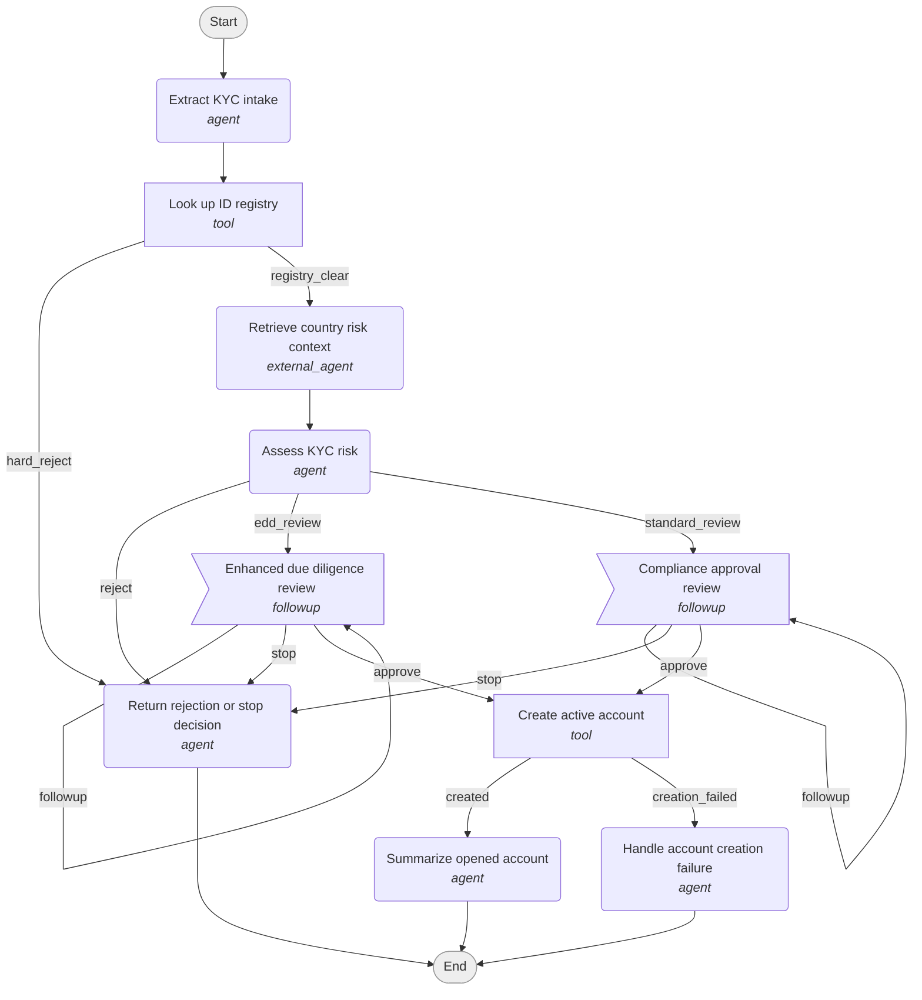

# Workflow

Retail KYC Onboarding, generated from the Kaya execution plan (version 1).

Start: extract_kyc_intake.

## Steps

Each step runs as a chain of ADK nodes named `<step>__<phase>`: an agent step `gate` (when it has a review gate), `prep`, `agent`, `post`; a follow-up step adds `ask` and `receive`; a tool step `approvals` and `run`; the external agent step `run`.
A phase that can pause is followed by a `__wait` node, and a step with a review gate also has a `halt` node, taken when the reviewer stops the run.
Every step enters through the engine's guard, which authorizes it and records the decision in the trace; credentials are added per tool or partner-agent call.

| Step | Kind | What it does | Next |
|------|------|--------------|------|
| `extract_kyc_intake` | agent | Extract KYC intake: model `gemini_3_8_flash`; prompt `kyc_intake_agent` | default |
| `look_up_id_registry` | tool | Look up ID registry: calls `retail_kyc_id_registry_lookup` | hard_reject, registry_clear |
| `retrieve_country_risk_context` | external_agent | Retrieve country risk context: calls the World Bank agent at `https://agentbazaar.tech/a2a/connectors/worldbank` over A2A; reply in `world_bank_country_risk_agent.response` | default |
| `assess_kyc_risk` | agent | Assess KYC risk: model `gemini_3_8_flash`; prompt `kyc_risk_agent_prompt` | edd_review, reject, standard_review |
| `compliance_approval_review` | followup | Compliance approval review: the KYC Risk Agent writes the question after its review gate, then waits for the officer's reply (ADK `RequestInput`) | approve, followup, stop |
| `enhanced_due_diligence_review` | followup | Enhanced due diligence review: as above, for medium-risk applicants (`APPROVE WITH EDD`) | approve, followup, stop |
| `create_active_account` | tool | Create active account: calls `retail_kyc_account_creation` | created, creation_failed |
| `summarize_opened_account` | agent | Summarize opened account: model `gemini_3_8_flash`; prompt `kyc_risk_agent_prompt` | default |
| `return_rejection_or_stop_decision` | agent | Return rejection or stop decision: model `gemini_3_8_flash`; prompt `kyc_risk_agent_prompt`; pauses at its review gate first | default |
| `handle_account_creation_failure` | agent | Handle account creation failure: model `gemini_3_8_flash`; prompt `kyc_risk_agent_prompt`; pauses at its review gate first | default |

## Routing

- `look_up_id_registry` chooses between hard_reject, registry_clear using `LOOK_UP_ID_REGISTRY` in `workflow/components/conditions.py`.
- `assess_kyc_risk` chooses between edd_review, reject, standard_review using `ASSESS_KYC_RISK` in `workflow/components/conditions.py`.
- `compliance_approval_review` chooses between approve, followup, stop using `COMPLIANCE_APPROVAL_REVIEW` in `workflow/components/conditions.py`.
- `enhanced_due_diligence_review` chooses between approve, followup, stop using `ENHANCED_DUE_DILIGENCE_REVIEW` in `workflow/components/conditions.py`.
- `create_active_account` chooses between created, creation_failed using `CREATE_ACTIVE_ACCOUNT` in `workflow/components/conditions.py`.

## Branch conditions

All five are in `workflow/components/conditions.py`, registered in `CONDITIONS` by step id:
`ASSESS_KYC_RISK`, `COMPLIANCE_APPROVAL_REVIEW`, `CREATE_ACTIVE_ACCOUNT`, `ENHANCED_DUE_DILIGENCE_REVIEW`, `LOOK_UP_ID_REGISTRY`.
